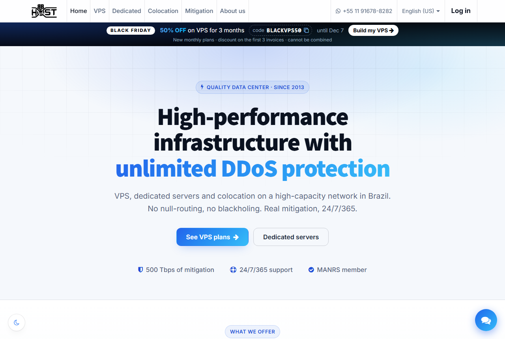
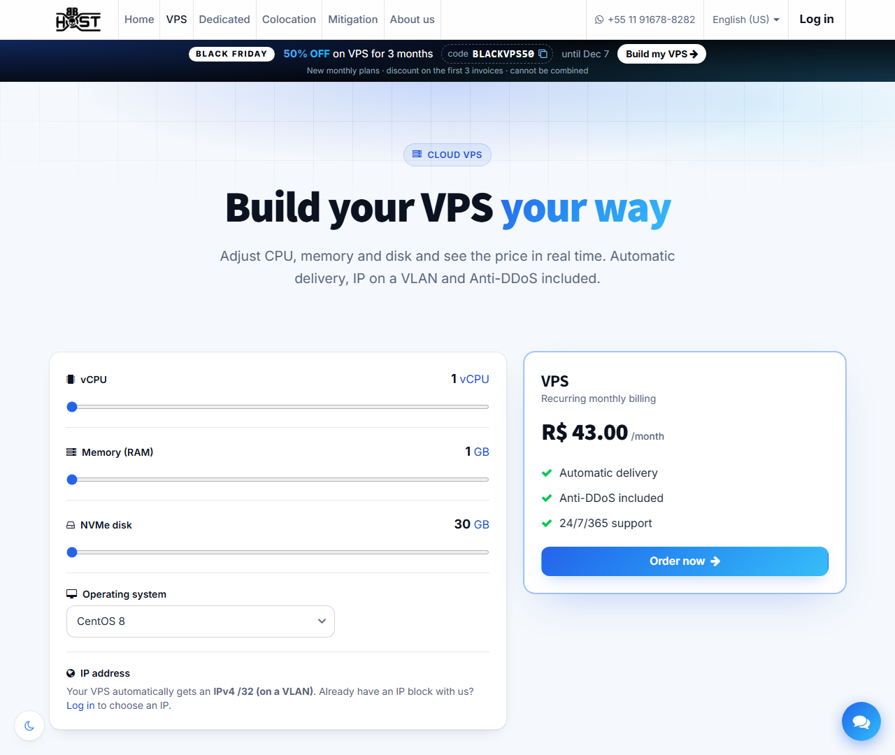
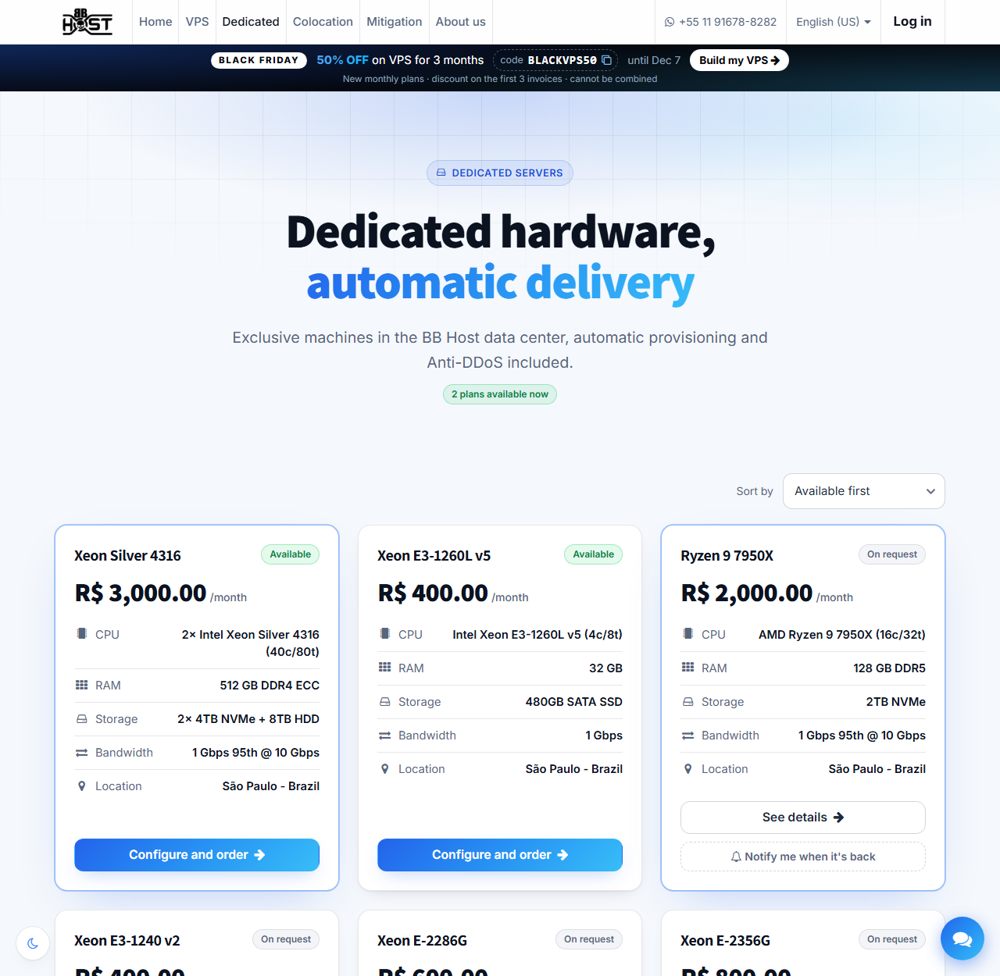
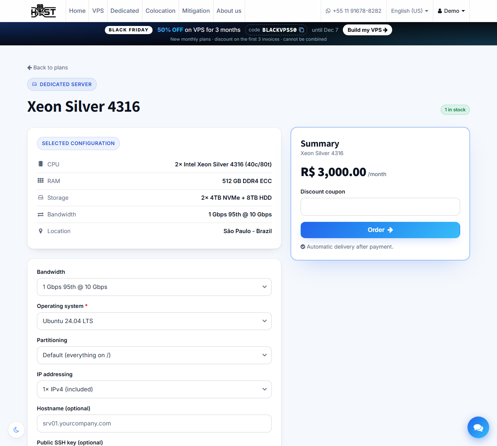
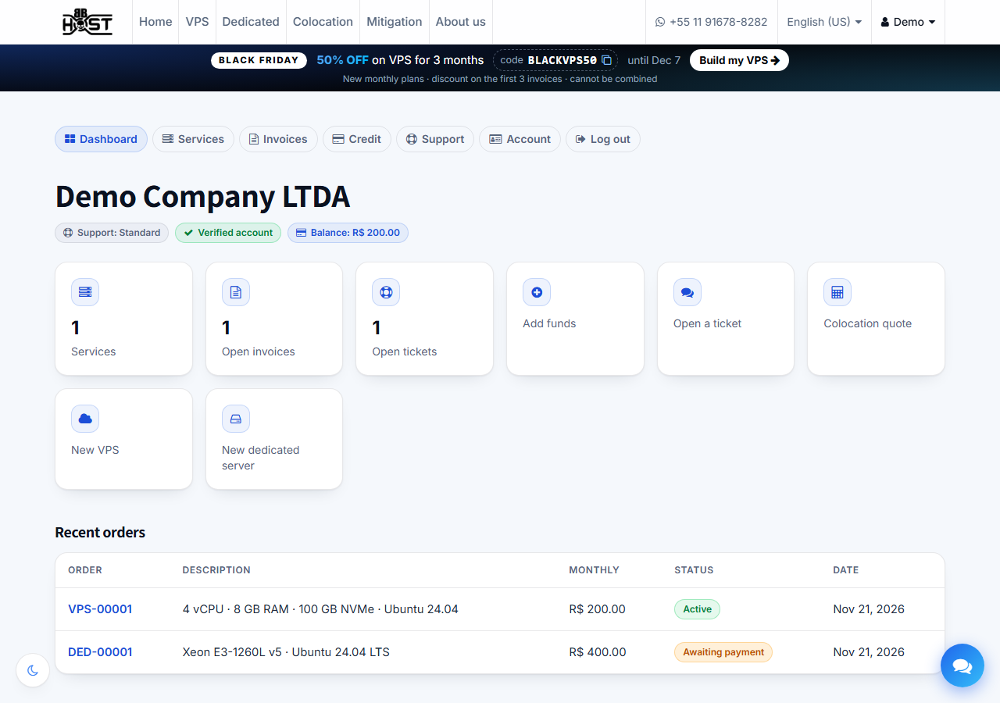
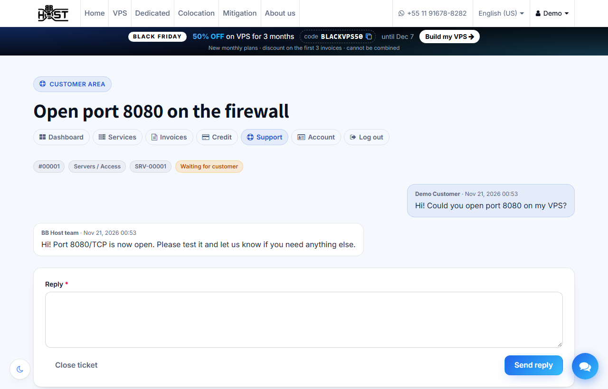
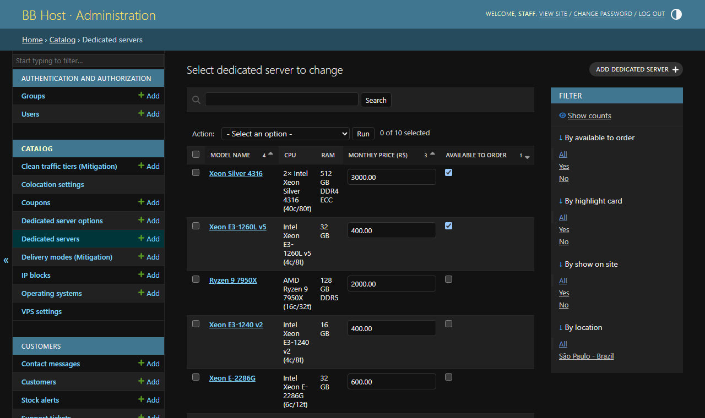

# BB Host — website and customer area for an infrastructure provider

[](https://github.com/mayara-menezes/bb-host/actions/workflows/ci.yml)


A **working** replica of the website of [BB Host](https://bbhost.com.br), a Brazilian provider of VPS,
dedicated servers, colocation and Anti-DDoS protection. The look of the public site was measured and
rebuilt from scratch with Tailwind CSS; on top of it I built the back end the site doesn't show: a catalog
with editable prices, customer accounts, VPS and dedicated server checkout, invoices, services, account
credit and support tickets.

> **Disclaimer:** study and portfolio project, not affiliated with BB Host. The name and logo belong to
> their owner and are used only to reproduce the layout. There are no real payments and no real customer
> data. Prices are in Brazilian reais (R$).



## What you can do

**Visitors**
- Build a VPS with vCPU, RAM and disk sliders and watch the price update in real time.
- Browse the dedicated server catalog, sort by price or availability and ask to be notified when a
  sold-out machine is back.
- Estimate colocation by rack space (U) and power (W), for several servers at once.
- Request an Anti-DDoS quote and send a message through the contact form.

**Customers (logged in)**
- Sign up with Brazilian tax ID validation (CPF/CNPJ) and log in with an e-mail address.
- Order a VPS (with a discount coupon) or a dedicated server with paid options: bandwidth, IP block,
  partitioning, operating system, panel license, hostname and SSH key.
- Track orders, invoices, active services and account credit.
- Open support tickets and talk to the team; request colocation (verified accounts only).

**Staff (Django admin)**
- Edit prices, servers, operating systems, IP blocks and coupons without touching the code.
  The coupon flagged "show in the top banner" becomes the promo banner at the top of the site.
- Mark invoices as paid (which creates the service automatically), activate services, verify
  accounts and reply to tickets.

## Screenshots

| VPS builder | Dedicated server catalog |
| --- | --- |
|  |  |
| **Configure a dedicated server** | **Customer dashboard** |
|  |  |
| **Support ticket** | **Admin: dedicated servers** |
|  |  |

More in [`docs/screenshots`](docs/screenshots).

## Technical highlights

- **Real domain modeling:** 23 models across 3 apps (catalog, customers, orders), with the
  *order → invoice → service* lifecycle handled by `Invoice.mark_paid()` inside a database transaction.
- **Historical prices preserved:** each order stores the price and specs at the time of purchase.
- **Calculated in the browser, validated on the server:** JavaScript only displays the total; the stored
  amount is always recalculated on the back end.
- **Frictionless flow:** visitors build the product before having an account; the choice is kept in the
  session and restored after sign-up.
- **Single-row "singleton" settings tables** for VPS and colocation pricing.
- **Quality:** 37 tests (unit and end-to-end flows), linting and formatting with Ruff, and GitHub Actions
  running everything on every push.
- **Tailwind design system:** the original site's colors, spacing and shadows became design tokens;
  semantic colors are CSS variables, so light and dark themes share the same utilities. Reusable
  components (`btn`, `card`, `badge`, `form-input`) are built with `@apply`, and Django form widgets get
  them automatically.
- **Environment-based configuration** (`.env`), with the secret key kept out of the code.

Details, the database diagram and design decisions are in [`docs/architecture.md`](docs/architecture.md).
How the original site was studied: [`docs/original-site-analysis.md`](docs/original-site-analysis.md).

## Tech stack

- **Back end:** Python 3.12, Django 6.1, SQLite
- **Front end:** Django templates, Tailwind CSS v4, Flowbite (dropdowns, mobile drawer), Font Awesome 4.7,
  plain JavaScript (no framework)
- **Quality:** Django test runner, Ruff, GitHub Actions
- **Development:** Django Debug Toolbar, python-dotenv

## Getting started

Requirements: Python 3.12+ and Node.js 20+ (only to build the CSS).

```bash
git clone https://github.com/mayara-menezes/bb-host.git
cd bb-host
python -m venv .venv
```

Activate the virtual environment:

```bash
# Windows (PowerShell)
.venv\Scripts\Activate.ps1
# Linux / macOS
source .venv/bin/activate
```

Install, configure and run:

```bash
pip install -r requirements-dev.txt
npm install                    # Tailwind CLI + Flowbite
npm run build                  # builds static/css/output.css
cp .env.example .env           # on Windows: copy .env.example .env
python manage.py migrate       # creates the database with the store catalog
python manage.py seed_demo --admin
python manage.py runserver
```

While editing templates, run `npm run dev` in a second terminal so Tailwind rebuilds the CSS on save.

Open <http://127.0.0.1:8000>. `seed_demo` creates two demo accounts (password `demo-bbhost-2026`):

| Account | Where to log in | What it has |
| --- | --- | --- |
| `demo@bbhost.local` | `/login` | active VPS, dedicated server awaiting payment, credit, colocation and an answered ticket |
| `admin@bbhost.local` | `/admin/` | full access to the staff dashboard |

## Tests and code quality

```bash
python manage.py test          # 37 tests
ruff check .                   # lint
ruff format --check .          # formatting
```

The flow tests (`orders/tests.py`) follow a real customer journey: build a VPS without logging in, get
sent to the login page, apply the coupon, place the order, pay the invoice and see the service show up.
They also cover invalid limits, a coupon for another product, a sold-out server and access to another
customer's ticket.

## Project structure

```
config/      settings and root URLs
home/        public pages
catalog/     products, prices, coupons (+ the |money template filter)
customers/   sign-up, login, profile, support tickets
orders/      orders, invoices, services, credit, colocation, mitigation, seed_demo
templates/   base layout and shared partials (header, footer, form field)
static/      src/input.css (Tailwind tokens + components), site.js and images
docs/        architecture, original site analysis and screenshots
```

## Roadmap

- Online payments (PIX and card) with automatic confirmation via webhook
- Automatic monthly renewals that issue invoices and use account credit
- Sub-accounts with permissions and two-factor authentication
- Transactional e-mails (order received, invoice, ticket answered)
- PostgreSQL and a Docker-based deployment

## Author

**Mayara Menezes** · [github.com/mayara-menezes](https://github.com/mayara-menezes)

Code released under the [MIT license](LICENSE) (see the note about the brand and styles at the end of the file).
