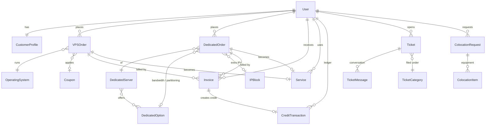
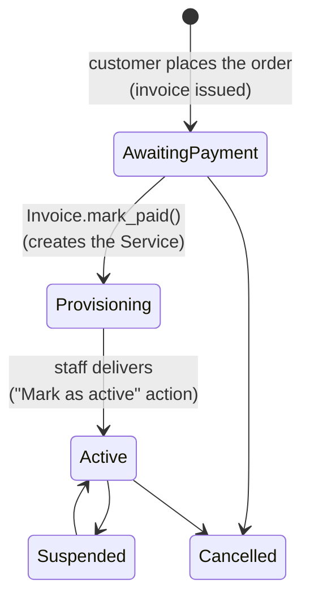

# Architecture

The project is a Django monolith split into four apps, each with a single responsibility:

| App | Responsibility | Key files |
| --- | --- | --- |
| `home` | Public pages and anonymous forms (contact, "notify me") | `views.py`, `templates/home/` |
| `catalog` | What is for sale and for how much: price tables editable in the admin | `models.py`, `context_processors.py`, `templatetags/bb.py` |
| `customers` | Who buys: sign-up, login, profile, support tickets | `models.py`, `forms.py`, `validators.py`, `views.py` |
| `orders` | What was bought: orders, invoices, services, credit, requests | `models.py`, `forms.py`, `views.py`, `management/commands/seed_demo.py` |

Dependencies point one way: `orders` uses `catalog` and `customers`; `catalog` depends on nothing.
The only exception is `customers.Ticket.service`, which references `orders.Service` by string, without an import.

## Data model

Single-row settings tables (`VPSSettings`, `ColocationSettings`) inherit from `catalog.models.Singleton`:
`save()` forces `pk=1`, `delete()` is blocked and the admin opens the edit form directly.

## Order lifecycle

`Invoice.mark_paid()` holds the business rule and runs inside a database transaction:

- **new order invoice** → the order moves to "Provisioning" and a `Service` is created with its next renewal one month ahead;
- **renewal invoice** → `next_renewal` moves forward by the service billing cycle;
- **credit invoice** → a top-up is recorded in the ledger (`CreditTransaction`); the balance is the sum of the ledger.

## Design decisions

**Price snapshot on the order.** `monthly_price`, the server name and its specs are stored on the order,
so changing the catalog tomorrow never changes what a customer bought today.

**Calculated in the browser, validated on the server.** VPS and dedicated totals update in real time in
JavaScript, reading prices from `data-*` attributes the server renders into the HTML
(`orders.forms.PricedSelect`). The stored amount is always recalculated on the back end
(`VPSSettings.calculate`, `DedicatedOrderForm.options_price`), so the client cannot tamper with the price.

**Configuration kept before login.** Visitors build a VPS or a colocation estimate without an account.
The choice goes into the session (`vps_config`, `colocation_items`) and is picked up again after
sign-up/login, so nobody has to fill the form twice.

**E-mail login without a custom user model.** Django's default `User` is kept; the e-mail is stored
(lower-cased) in `username` as well, and the extra data lives in a one-to-one `CustomerProfile`.

**Brazilian tax IDs.** CPF and CNPJ check digits are validated (`customers/validators.py`);
passports and foreign IDs are only normalized, just like in the original system.

**Front end in Tailwind CSS v4 + Flowbite.** The original site's colors, spacing, radii, shadows and
gradients were measured and turned into design tokens in `static/src/input.css`. Semantic colors
(`bg-page`, `bg-surface`, `text-ink`, `text-muted`, `border-line`...) are CSS variables that switch under
the `.dark` class, so one utility works in both themes without `dark:` duplicates. A small set of
components (`btn`, `card`, `badge`, `form-input`...) is built with `@apply`; layout and one-off spacing stay
as utilities in the templates. Flowbite provides the dropdowns and the mobile drawer, and Django form
widgets receive the component classes automatically (`customers.forms.StyledFormMixin`).

**Currency.** Prices are in Brazilian reais (R$) and formatted with the `money` template filter
(`3,000.00`), matching the English interface.

## Main routes

| Route | Who | What it does |
| --- | --- | --- |
| `/`, `/vps`, `/dedicated`, `/colocation`, `/mitigation`, `/about`, `/contact` | public | site pages |
| `/dedicated/<slug>/configure` | public (ordering requires login) | paid options and ordering |
| `/vps/checkout` → `/vps/review` | public → logged in | builder → review with coupon |
| `/signup`, `/login`, `/logout` | public | customer account |
| `/account/...` | logged in | dashboard, services, invoices, credit, support, profile |
| `/admin/` | staff | catalog, customers, orders and billing |
